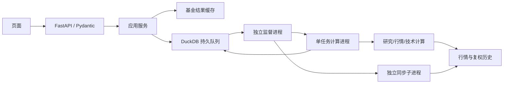

# 架构设计

更新：2026-10-30。后端从Flask迁移为FastAPI，环境采用uv，研究算法与数据口径不变。

## 模块边界

| 模块 | 职责 |
| --- | --- |
| src/market_research/api/app.py | ASGI工厂、lifespan、错误映射、请求大小限制、静态资源与Uvicorn CLI |
| webapp/api/ | 元信息、基金分析、股票/指数、同步、任务路由；不执行长时计算 |
| src/market_research/api/schemas.py | Pydantic v2请求与提交响应模型、模型参数与窗口校验 |
| src/market_research/services/analysis.py | 任务命令编排、基金结果缓存；供接口和worker共同调用 |
| src/market_research/tasks/store.py | DuckDB持久队列、跨进程去重、限流、心跳租约、恢复与尝试令牌 |
| src/market_research/tasks/worker.py | 单实例监督进程，按容量启动独立计算子进程，管理超时、崩溃重试与同步子进程 |
| src/market_research/tasks/processes.py | 跨进程单实例锁、同环境子进程启动与日志重定向 |
| src/market_research/settings.py | 运行目录与服务、队列、超时环境配置 |
| src/market_research/tasks/jobs.py | 对核心计算暴露持久JOBS；保留内存JobStore/回调JobRunner供隔离测试与本地使用 |
| src/market_research/market/analysis.py / src/market_research/market/technical.py | 股票/指数行情与技术分析，独立于基金拟合 |
| src/market_research/funds/analysis.py / src/market_research/funds/payloads.py | 基金计算用例与结果组装，无HTTP框架依赖 |
| src/market_research/tasks/sync.py | 已添加资产历史补齐、复权刷新、增量合并及持久同步状态 |
| src/market_research/data/storage.py / src/market_research/data/marketdata.py | DuckDB事务与文件锁、数据源、净值口径和面板对齐 |
| src/market_research/modeling/models.py / src/market_research/modeling/backtest.py | 模型与研究回测核心，CLI与Web复用 |

## 执行流

接口只保存可序列化命令和参数，不向进程传递闭包。队列与行情共用既有DuckDB文件锁边界，跨进程请求、去重与领取串行协调。已有prices/datasets表不重建；003_jobs.sql为加性任务表迁移，001/002保留同步状态。

## 生命周期与恢复

API启动时初始化任务表；默认启动独立监督进程，文件锁确保单实例。API停止不会关闭工作进程；需要停止时使用worker --stop。FIL_AUTO_SERVICES=0可由外部进程管理器分别管理API和worker。

queued/running任务最多100个（可配置），每次领取全局限制分析并发数。任务子进程每5秒续约，租约45秒；监督进程发现子进程退出后将未完成任务重新排队，默认最多3次。业务异常直接终态失败，避免重复网络请求；超时默认900秒并终止子进程。每次领取有独立token，旧尝试不能写入新尝试的进度或结果。终态不可被迟到消息覆盖。

结果在队列表中以JSON持久化，任务API重启后继续可查；终态24小时后在下次提交时清理。取消通过状态通知监督进程终止子进程，不取消其他任务。此方案针对单机本地文件系统，不支持共享网络盘或多主机分布式队列。

同步由监督进程启动独立单次子进程，完成后30秒再检查；Windows每日任务也可直接启动sync --once。两者共用同步锁，网络或原生库异常不进入API进程。新增证券历史补齐、复权历史整段刷新策略保留。

## 环境与接口兼容

pyproject.toml定义可安装包、控制台入口、Python范围及依赖；uv.lock固定传递依赖，.python-version固定验证版本。静态资源和SQL迁移随wheel打包。开发及定时任务统一使用.venv。FIL_HOME/FIL_DATA_DIR使源码路径与运行数据目录可分离。

所有原有/api路径和JSON字段保留；请求校验仍为400，任务容量错误429，未完成结果202。新增/docs与/openapi.json。前端不依赖Flask，日期、下拉控件和分析面板保持现状。部署可使用Uvicorn，多个API进程须共用同一数据目录与独立worker。

## 数据与研究边界

结构迁移没有改变复权、基金月度锚点校准和回测交易假设。当前历史数据可能事后修订，仍不能据此声称严格时点可得或可执行交易收益。

## 股票趋势与方向预测（2026-10-30）

`src/market_research/market/technical.py` 是独立纯计算层：Wilder平滑、日线指标、因果规则、首次条件事件，以及带标签成熟间隔的滚动方向模型。它不访问网络、数据库或HTTP框架，不发送交易订单；`src/market_research/market/analysis.py` 负责读取并核对复权历史后调用，输出 `technical` 可选块，指数/基金不使用该模块。

方向模型在每个预测时点 t 仅使用标签终点不晚于 t 的样本，固定模型参数与21日重估周期；标准化与分类器均只拟合训练窗口。展示区间与训练预热区间独立。历史验证抽取非重叠周期的成熟预测，与当时训练集频率基准比较；样本不足和无基准优势显式展示。当前是同一修订版历史上的时间滚动验证，尚非历史时点可得的实盘回测。

前端 `market.js` 渲染规则、预测比较、布林叠加、MACD/RSI与事件日志；使用当前日期对齐技术叠加，数据不足时局部降级。交易参考价始终保留复权坐标说明，指标规则与方向模型矛盾时单独提示。
