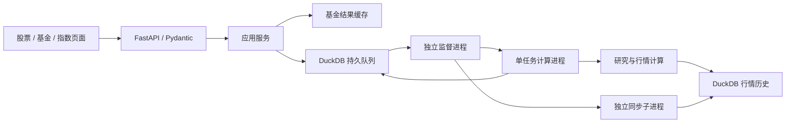

# 架构设计

核对日期：2026-10-31。当前实现为 uv + FastAPI + Uvicorn + 独立计算子进程 + DuckDB 持久任务。文件与命令详表由[模块与入口](模块与入口.md)维护，功能缺口由[功能完整性检查](功能完整性检查.md)维护。

## 模块边界

| 位置（相对 src/market_research/） | 职责 |
| --- | --- |
| api/app.py、api/routes/、api/schemas.py | ASGI 生命周期、路由、校验、错误映射与静态资源 |
| api/static/ | 股票/基金/指数页面、数据中心、日期与下拉控件 |
| services/analysis.py | 可序列化任务参数、结果缓存与核心用例编排 |
| tasks/store.py、tasks/worker.py、tasks/processes.py | 持久任务、租约/尝试令牌、进程监督、单实例锁与日志 |
| tasks/sync.py | 资产登记、已添加资产历史补齐、增量/复权刷新与同步状态 |
| market/analysis.py、market/technical.py | 股票/指数行情用例与独立技术计算 |
| funds/ | 基金分析、结果组装、RBSA、持仓与样本池 |
| modeling/ | 模型目录、单窗口估计、滚动引擎、信号、回测与趋势 |
| data/providers/、data/cache.py、data/panels.py | 数据获取、缓存、总回报校准和内存对齐 |
| data/storage.py、data/migrations/ | DuckDB 事务、内容指纹、统计及加性迁移 |
| cli/registry.py、cli/main.py、research/commands/ | 命令唯一映射、延迟加载和研究入口 |
| settings.py、config.py、validation/、serialization.py | 运行配置、研究配置、业务规则和有限数值 JSON |

`data/marketdata.py` 和 `modeling/models.py` 是稳定导入门面。核心模块不反向依赖 HTTP 层；API 与 worker 共用服务和领域实现。新增命令登记到注册表，不增加根目录 `run_*` 文件。

## 执行流

接口持久化可序列化命令与参数，不传闭包给计算进程。API 不在请求内执行长时分析。基金结果缓存命中时可直接返回；新计算通过任务轮询返回结果。

## 存储与迁移

`FIL_DATA_DIR/market.duckdb` 保存以下内容：

| 表 | 内容 |
| --- | --- |
| datasets | 数据集元信息、列类型、索引信息与 revision |
| prices | 按 dataset/date/asset 保存数值；asset 也可表示 OHLC 等字段 |
| sync_assets | 证券/口径登记、成功/尝试时间、错误及排队状态 |
| analysis_jobs | 可序列化任务、状态、租约、尝试令牌和 JSON 结果 |

基础行情表由 storage 初始化；`001_sync.sql`、`002_sync_state.sql`、`003_jobs.sql` 从包内 `data/migrations/` 顺序执行，均为可重复的加性迁移。迁移不重建既有行情。

短连接由线程锁和跨进程文件锁 `market.lock` 协调，数据集替换在事务中完成。同步另有批次锁。这里的 DuckDB 是单机存储与协调方案，不能视为支持网络盘、多主机写入的分布式数据库。

行情不再写 CSV/Parquet；旧行情 CSV 可导入且不删除。报告、研究结果、持仓和基金池仍可使用 CSV。基金计算结果使用本地版本化 pickle 缓存；任务结果使用队列表 JSON，二者生命周期不同。全局 `data_stamp()` 对所有行情数据集求摘要；基金结果指纹排除股票日线、股票同步历史及其他基金的净值/同步历史，共享指数、估值与未知数据集保守保留。计算期间指纹变化时不写结果缓存，避免旧结果绑定新数据版本；首次取数也可能因此跳过缓存。

## 任务生命周期

API 启动时初始化队列，默认启动独立 worker，文件锁确保单实例。API 退出不会停止 worker；`market-research-worker --stop` 才停止监督进程。`FIL_AUTO_SERVICES=0` 可交由外部进程管理器管理。

状态为 `queued → running → done/error`。默认队列总上限 100、分析并发 2、单次超时 900 秒。计算子进程每 5 秒续约，租约 45 秒；进程意外中断后可重新排队，默认最多 3 次尝试，正常业务异常直接失败。每次领取使用独立 token，过期进程不得覆盖新尝试或终态。

任务状态和结果跨 API 重启保留，终态 24 小时后在下次提交时清理。取消将任务置于错误终态并由 worker 终止对应子进程；切换资产入口仅停止前端接收旧任务更新，不取消后台计算。持久队列不提供长期研究档案或历史实验列表。

## 同步生命周期与复权

worker 启动单次同步子进程，完成后约 30 秒检查下一批；独立 sync 服务及 Windows 任务也调用同一调度逻辑并共用同步锁。只处理已登记资产，不依据全市场名录扩展范围。

首次从 1990-01-01 请求可用历史；不复权股票/指数后续重取最近 10 个自然日并合并。复权股票与基金每次重建完整历史，避免公司行动和校准修订导致新旧口径混用。空数据、倒退或截断时保留旧数据，错误状态可重试。完整策略、时间配置和 Windows 安装见 [README](../README.md#数据存储与每日同步)。

## 股票技术分析边界

`market/technical.py` 是纯计算层，负责 Wilder 平滑、技术指标、因果规则和标签成熟约束下的滚动方向模型；不访问网络、数据库或 HTTP。`market/analysis.py` 读取并核对复权历史后调用。指数和基金不使用该股票技术模块。

每个预测时点仅使用标签终点不晚于当时的训练样本。标准化与分类器只拟合训练窗口，历史验证按预测周期间隔抽取成熟预测并比较当时频率基准。规则分不等于概率，Brier 优劣不等于显著性；当前是修订版历史上的滚动验证，不能称为严格时点可得回测。

## 打包与兼容

`pyproject.toml` 定义包、4 个控制台入口、Python 范围及依赖，`uv.lock` 锁定依赖。静态资源由 `market_research.api` 包资源定位，SQL 由 `market_research.data` 包资源定位，均随 wheel 发布。

`FIL_HOME` 与 `FIL_DATA_DIR` 分离源码和运行产物。旧 `src.*`、`webapp.*` 转发集中在 `compat/`，保留同一模块对象及历史 pickle 类路径。源码工作区只有两个包搜索桥接文件；wheel 直接安装兼容包。归档脚本在 `compat/entrypoints/`，源码调用方式见入口文档。

当前公开 `/api/*` 协议由路由及 Pydantic 模型定义，参数错误为 400，队列容量错误 429，未完成结果 202；OpenAPI 可在 `/openapi.json` 查看。不要使用历史 Flask 提案中的路由或线程执行方式描述当前后端。

## 数据与研究解释

结构迁移没有消除基金月度锚点的事后校准、股票复权历史修订、披露时间缺失及简化交易成本等限制。滚动样本外预测与端到端历史时点可得收益是不同保证。历史实验日期和窗口详见[研究方案](研究方案.md)，本次结构与文档调整没有重算其数值。

## 行情覆盖信息

股票/指数分析在返回结果的 quality 中记录 requested_start/end、actual_start/end、end_gap_calendar_days、fetched_at 和 reference_missing_count/dates。缺日线仅在实际首末日之间相对可用基准统计，排除上市前和尾部区间；明细最多 10 条。calendar_verified 固定为 false，reference_checked 表示是否有可用基准用于核对，尚未接入交易所日历。页面显示请求区间及相应提示，不把周末自然日差距判为过期。

## 缺失指数恢复与元信息一致性

读取不完整的候选指数池时仅补取缺列，成功序列合并保存，补取失败保留已有行情。描述性 info 的合并在 storage 的跨进程锁内完成，避免读取旧元信息后覆盖新的数据口径。结果指纹同时包含数据 revision 和去除 info 的当前元信息，只有版本/口径变化会因元信息更新触发缓存失效，抓取时间等描述字段不会。首次使用新指纹会自然重算旧结果，无需删除行情库。
