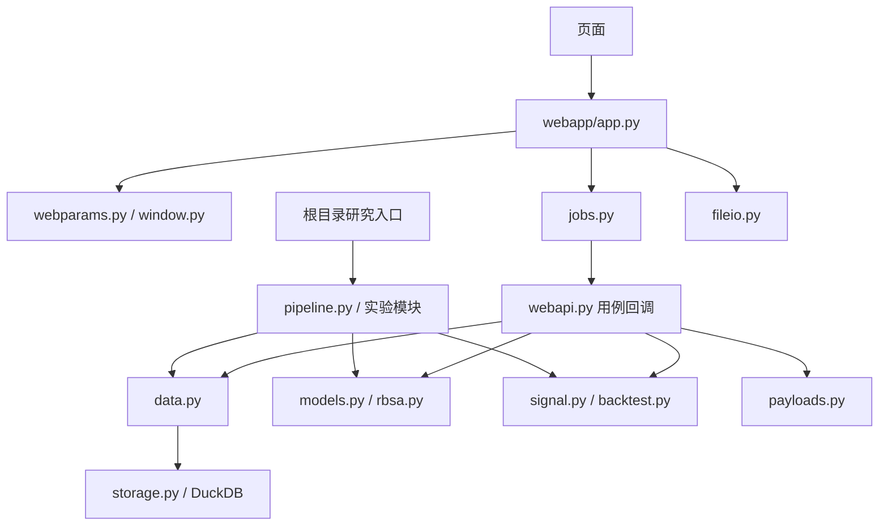

# 项目架构与维护约束

更新：2026-10-29。面向本机运行的研究应用：一个 Web 进程管理后台线程，拟合可在子进程中并行。行情直接使用 DuckDB。

## 目录与职责

| 位置 | 职责 | 应避免的依赖 |
|---|---|---|
| 根目录 `run*.py`、`warm_cache.py`、`migrate_cache.py` | 已有 CLI 入口、参数解析与产物输出 | 不复制拟合、取数和回测算法 |
| `webapp/app.py` | HTTP 校验错误映射、结果缓存、提交用例、轮询 | 不直接管理线程与信号量 |
| `webapp/static/` | 页面状态与图表交互 | 不重算金融指标 |
| `src/webapi.py` | 分析、重算、回测用例的步骤编排 | 不依赖 Flask，不构造线程 |
| `src/payloads.py` | 将计算结果组装为图表、指标和结论字典 | 不抓取行情、不落盘、不提交任务 |
| `src/jobs.py` | 任务状态、去重、限流、线程生命周期 | 不依赖模型、数据源或 Flask |
| `src/webparams.py` | 请求模型参数合法性检查 | 不依赖 HTTP 请求上下文 |
| `src/window.py` | CLI/Web 共用 ISO 日期格式及最短区间规则 | 不分别维护两套日期算法 |
| `src/data.py` | 免费数据源抓取、口径、缓存策略与面板对齐 | 不在路由里另建取数通道 |
| `src/storage.py` | DuckDB 读写、事务、文件锁、元信息和数据库统计 | 不包含数据源抓取和拟合规则 |
| `src/fileio.py` | 派生结果与持仓导出的原子写入 | 不存储行情主数据 |
| `src/models.py`、`src/rbsa.py` | 统一滚动拟合引擎及 RBSA 兼容入口 | 不依赖页面或任务调度 |
| `src/signal.py`、`src/backtest.py` | 信号与研究回测 | 不读 HTTP 参数 |
| `src/pipeline.py`、实验模块 | CLI 研究流程、稳健性检验和报告 | 复用模型与回测核心 |
| `src/runinfo.py` | 代码、依赖、配置、DuckDB 数据指纹和缓存规模 | 不用 CSV 备份数量代表数据库内容 |

根目录脚本保留原路径，避免破坏已有命令、文档和外部调用。`src/webapi.py` 保留原有函数导入别名；新调用应直接导入所属模块。

## 主要调用关系



`jobs.py` 接受计算回调，箭头表示执行流，不表示它导入 `webapi.py`。结果组装只消费内存中的 Series、DataFrame 和模型报告。

## 任务与错误处理

分析、单模型重算和回测统一调用 `JobRunner.submit()`。在同一临界区完成任务去重、名额获取及任务创建；相同任务复用 job_id，容量不足返回 429。线程启动失败、计算抛错和正常返回均回收名额。

任务状态从 running 到 done/error 后不可被迟到的进度、成功或失败覆盖。超时、取消只改变公开状态；Python 线程不能安全强杀，名额在实际计算返回后释放。当前没有分布式任务队列，也没有跨 Web 进程共享状态，因此使用现有单进程启动方式。

行情刷新先抓取，再在事务内替换数据；抓取或写入失败保留上一版。派生缓存写失败不影响已经成功的分析。名称缓存与分析缓存复用同一份原子文件写入实现。

## 数据与股票扩展

`prices(dataset, date, asset, value)` 保存数值，`datasets` 保存口径、列类型、日期精度和内容指纹。CSV 仅作为行情迁移来源；结果导出和真实持仓明细仍可使用 CSV。

数据库没有固定基金代码列，因此可容纳股票数值序列。股票行情接入时在 `data.py` 中增加实际需要的数据源函数，遵守市场前缀、字段及复权口径的命名规范。等 OHLCV、多字段查询需求明确后再决定是否增加专用表；本轮没有添加股票数据接口或通用 provider 框架。

扩展股票前必须确定分红、拆分、退市、历史成分及发布时间的口径。现有基金月度锚点校准仍属于事后数据，结构重构没有解决历史时点可得性，不能据此声称回测无前瞻。

## 验证命令

```shell
python tests/test_jobs.py
python tests/test_storage_routes.py
python tests/test_p0_fixes.py
python tests/test_regressions.py
node tests/test_refit.js
python tests/test_webapi.py 110022 3
```

前五项验证任务、存储、数值边界及前端重算行为。最后一项使用已缓存行情执行多模型拟合和结果组装；缓存缺失时可能联网。`tests/dom_check.js` 需要运行中的服务及 jsdom，用于额外验证页面渲染。
